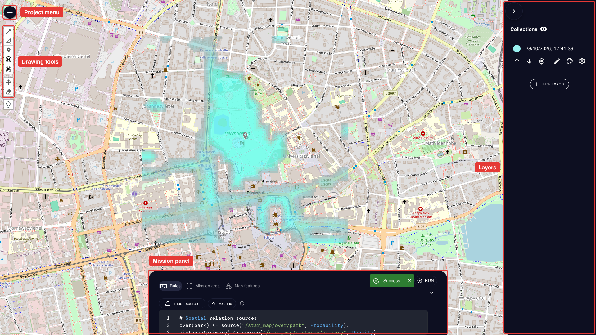

Graphical User Interface
========================

ProMis comes with a browser-based GUI to design missions interactively.
You write the mission rules, choose the map features they refer to, and see the resulting mission landscape on the map, without writing any Python.

Starting the GUI
----------------

Once ProMis is installed as described above, start the GUI with

.. code-block:: bash
    :linenos:

    promis_gui

and open `http://localhost:8000/gui <http://localhost:8000/gui>`_ in a browser of your choice.
The options ``--host`` and ``--port`` change where the GUI is served, e.g., ``promis_gui --host 127.0.0.1 --port 8080``.
The backend also documents its HTTP endpoints under `http://localhost:8000/docs <http://localhost:8000/docs>`_.

The GUI keeps its state in the folder ``.promis_gui`` in your home directory:
``config`` holds the drawn objects, location types and layers, so that they are restored on the next start,
and ``cache`` holds downloaded map data and computed StaR Maps, so that repeated runs are fast.
Both can be deleted at any time to start over.

Overview
--------

The GUI consists of four parts around the map:

* **Mission panel** (bottom): opened with the arrow button at the bottom of the screen. Its three tabs hold everything needed for a run:

  * **Rules**: the mission rules, written in Resin.
  * **Mission area**: the area around an origin marker in which the landscape is computed, and how finely.
  * **Map features**: the location types used by the rules, e.g., ``primary`` in ``distance(primary)``, and where their map features come from.

  The **Run** button computes the mission landscape, and the button next to it hides the panel.
* **Drawing tools** (left): draw lines, polygons and markers, e.g., an operator or a no-fly zone, and move or erase them.
  The lightbulb toggles whether drawn objects are shown on top of the computed layers.
* **Layers** (right): opened with the button in the top right corner. It lists the computed landscapes and imported CSV layers, and sets how each one is rendered.
* **Project menu** (top left): import or export the whole project, export all layers as GeoJSON, or clear all layers.

Most labels have an info icon next to them, which explains the element when hovered.

Your first mission landscape
----------------------------

The GUI starts with an example mission that permits flights over parks and close to roads, railways and crosswalks around the Herrngarten park in Darmstadt.
To compute it:

#. Click the arrow button at the bottom of the screen to open the mission panel.
   The **Rules** tab shows the example rules.
#. Open the **Mission area** tab.
   The origin is ``Default origin``, the gray marker in the park, which is chosen automatically as long as it is the only origin marker.
   The area is 1024 m wide and high by default.
#. Open the **Map features** tab to see the location types of the example.
   For instance, ``primary`` loads primary roads from `Overture Maps <https://overturemaps.org>`_ with the filter ``segment[subtype=road][class=primary]``.
#. Click **Run**.
   The button shows the progress while the GUI loads the map features, estimates the spatial relations of the rules and computes the landscape.
   The result appears as a new layer on the map.

The first run downloads the map features of the area, which takes a while.
Later runs reuse what is still valid: changing a threshold in the rules or the display settings reuses the computed spatial relations, and adding a location type only downloads its own features.

If a field is empty or invalid, **Run** outlines it in red and marks its tab with a red dot instead of starting, see :doc:`the guide<gui_quick_start>`.

Next steps
----------

The :doc:`GUI guide<gui_quick_start>` explains each part in detail: writing rules, choosing the mission area, loading map features from Overture Maps or OpenStreetMap, drawing your own objects, sending objects to the GUI from Python, and working with layers and projects.
