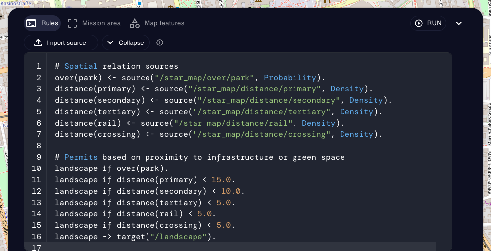
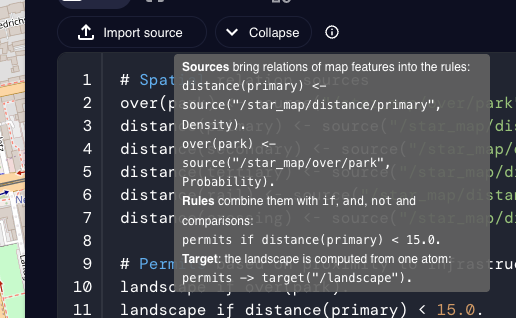
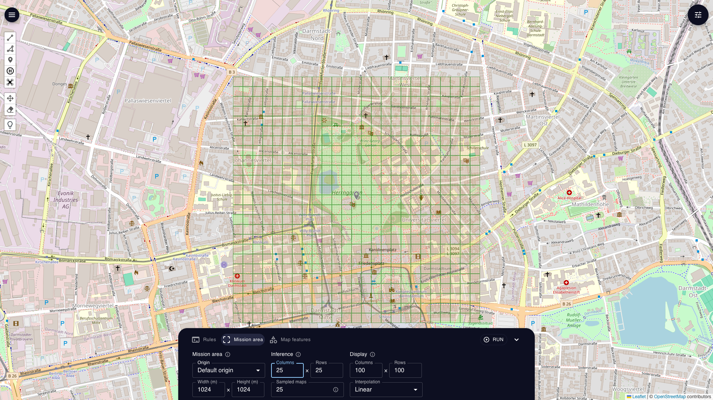
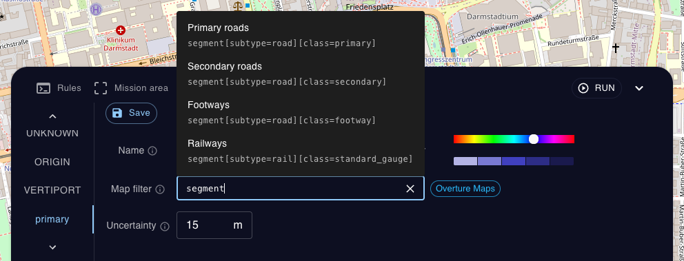
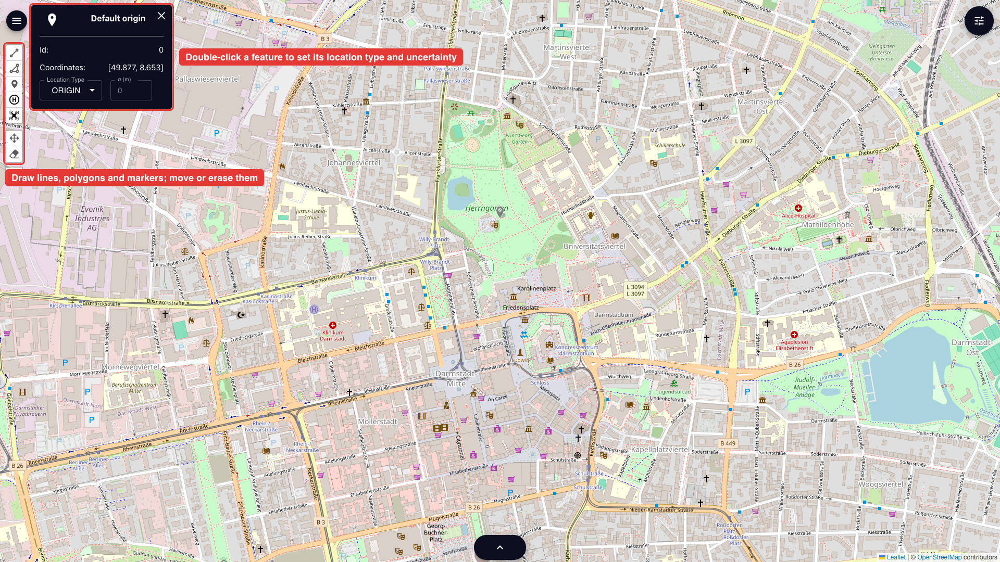
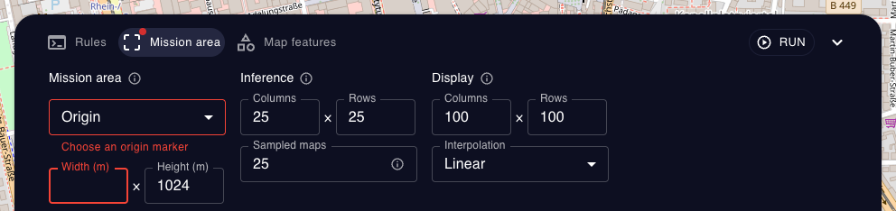

GUI Guide
=========

This guide walks through the parts of the GUI in the order of a mission design:
the rules, the mission area, the map features the rules refer to, and running the computation.
See :doc:`Graphical User Interface<gui>` for how to start the GUI and a first example run.

Rules
-----

The **Rules** tab of the mission panel holds the mission rules, written in Resin.
You can type them in the editor, or load a ``.pl`` file with **Import source**.
**Collapse** shrinks the editor to see more of the map.

A program has three parts:

* **Sources** bring the spatial relations of map features into the rules.
  ``distance(primary)`` is the distance to the nearest primary road, and ``over(park)`` whether a location lies within a park.
  Both are estimated by ProMis as StaR Maps, under the uncertainty of the map data.
  Each relation used by the rules is declared as a source, with a channel ``/star_map/<relation>/<location type>``:

  .. code-block:: prolog

      distance(primary) <- source("/star_map/distance/primary", Density).
      over(park) <- source("/star_map/over/park", Probability).

  The supported relations are ``distance``, ``over`` and ``depth``.
  ``distance`` and ``depth`` are declared as ``Density``, ``over`` as ``Probability``.
* **Rules** combine relations with ``if``, ``and``, ``not`` and comparisons:

  .. code-block:: prolog

      landscape if over(park).
      landscape if distance(primary) < 15.0 and not over(water).

  Several rules for the same atom are alternatives, i.e., any one of them suffices.
* **Target**: one atom is sent to the landscape channel, and its probability at each location becomes the mission landscape:

  .. code-block:: prolog

      landscape -> target("/landscape").

  The atom can have any name, e.g., ``permits -> target("/landscape").``

Hovering the info icon next to **Collapse** shows a short version of this syntax:

Mission area
------------

The **Mission area** tab sets where the landscape is computed, and how finely.
While one of its fields is selected, the map outlines the mission area with the inference grid (green) and the finer display grid.

* **Mission area**: the rectangle in which map features are loaded and the landscape is computed.
  It is centered on an **Origin**, a marker of the location type ``ORIGIN``, and spans **Width** and **Height** in meters.
  The GUI starts with the marker ``Default origin``.
  To use another one, place a marker on the map and give it the type ``ORIGIN``, see `Drawing objects`_.
* **Inference**: the grid of **Columns** and **Rows** on which the spatial relations and the landscape are computed.
  **Sampled maps** is the number of randomly varied versions of the map that the relations are estimated from.
  Finer grids and more samples are more accurate but slower.
* **Display**: the finer grid that the landscape is interpolated onto for display, and the **Interpolation** method:
  ``Linear`` blends between neighboring cells, ``Nearest`` copies the closest cell and is fastest, and ``Gaussian process`` gives a smooth fit but is slowest.

More on how the relations are estimated can be found in the paper `StaR Maps: Unveiling Uncertainty in Geospatial Relations <https://arxiv.org/abs/2412.18356>`_.

Map features
------------

The **Map features** tab lists the location types, one per tab.
A location type is the name that the rules use for a kind of map feature, e.g., ``primary`` in ``distance(primary)``.
Each one has

* a **Name**, as used in the rules,
* a **Map filter**, which selects the features loaded from map data, see `Map filters`_,
* an **Uncertainty**, the standard deviation in meters by which the loaded features are randomly shifted when the relations are estimated,
* a **Color**, used for its objects on the map.

**New type** adds a location type, **Edit** changes the selected one, and **Delete** removes it.
**Pick on map** assigns objects that you have drawn to the selected type: click it, then click the objects on the map, and click **Done picking** when finished.
The built-in types ``UNKNOWN``, ``ORIGIN`` and ``VERTIPORT`` have no filter and only contain objects drawn or picked on the map.

Map filters
^^^^^^^^^^^

By default, features are loaded from `Overture Maps <https://overturemaps.org>`_.
A filter names an Overture type, followed by optional conditions on its properties in brackets:

.. list-table::
    :header-rows: 1

    * - Filter
      - Loads
    * - ``building``
      - all buildings
    * - ``segment[subtype=road][class=primary]``
      - primary roads
    * - ``segment[subtype=rail][class=standard_gauge]``
      - railways
    * - ``segment[subtype=road][class=footway][subclass=crosswalk]``
      - crosswalks
    * - ``land_use[subtype=park]``
      - parks
    * - ``water``
      - all water bodies
    * - ``place[basic_category=restaurant]``
      - restaurants
    * - ``place[taxonomy.primary=art_museum]``
      - art museums, using a dotted key for a nested property

The types are ``building``, ``segment``, ``land_use``, ``land_cover``, ``water``, ``place`` and the others of the `Overture schema <https://docs.overturemaps.org/schema/>`_, which also lists the properties and values of each type.
Conditions are written as ``[key]`` (the property exists), ``[key=value]``, ``[key!=value]`` or ``[key~regex]``, and all conditions of a filter must hold.

Filters that start with a bracket are loaded from OpenStreetMap instead, using its tag filters, e.g., ``[highway=primary]`` or ``[leisure=park]``
(see the `Overpass query language <https://wiki.openstreetmap.org/wiki/Overpass_API/Language_Guide#Tag_request_clauses_(or_%22tag_filters%22)>`_).

While editing, the filter field suggests examples, and a chip next to it shows where the features will come from.
Invalid filters are explained below the field and cannot be saved.

Only the location types that the rules use are loaded, and only within the mission area.

Drawing objects
---------------

Besides loading map data, you can draw objects yourself, e.g., an operator position, a landing site or an area to avoid.
The toolbar on the left draws lines, polygons, markers, landing sites and drones, moves objects, and erases them.
Double-click an object to open its info box, where you can set its **Location Type** and the uncertainty of its position **σ (m)**.
Newly drawn objects have the type ``UNKNOWN`` until you give them a type, either in the info box or with **Pick on map**.

Objects of a location type are combined with the features loaded by its filter, so drawn objects can add to map data or replace it.

Sending objects from Python
---------------------------

Objects can also be sent to a running GUI, either from ProMis or over HTTP.
In ProMis, locations, lines, polygons and whole maps have a ``send_to_gui`` method:

.. code-block:: python
    :linenos:

    from promis.geo import PolarLocation
    from promis.loaders import OvertureLoader

    # send a marker to the GUI
    location = PolarLocation(latitude=49.87, longitude=8.65, location_type="operator", identifier=0)
    location.send_to_gui()

    # send all features of a map to the GUI
    feature_description = {
        "park": "land_use[subtype=park]",
        "primary": "segment[subtype=road][class=primary]",
    }
    origin = PolarLocation(latitude=49.87, longitude=8.65)
    width, height = 1000.0, 1000.0
    uam = OvertureLoader(origin, (width, height), feature_description).to_polar_map()
    uam.send_to_gui()

Over HTTP, the endpoint ``POST /add_geojson`` adds or updates an object from a GeoJSON feature with a point, line string or polygon geometry.
Its ``location_type`` property sets the location type, and its ``id`` identifies the object for later updates:

.. code-block:: json

    {
        "type": "Feature",
        "geometry": {
            "type": "Point",
            "coordinates": [8.65, 49.87]
        },
        "properties": {
            "location_type": "operator"
        },
        "id": "0"
    }

.. code-block:: bash
    :linenos:

    curl -X POST http://localhost:8000/add_geojson \
        -H "Content-Type: application/json" \
        -d @entity.geojson

Running
-------

**Run** first checks that everything needed is filled in.
Empty or invalid fields are outlined in red, and their tabs are marked with a red dot, here a missing origin and an empty width:

Otherwise, the run proceeds in three steps, which the button shows while they run:

#. **Loading Map Data**: the features of the location types used by the rules are loaded within the mission area.
#. **Calculating StarMap**: the spatial relations used by the rules are estimated on the inference grid, from the loaded features and the drawn objects.
#. **Inference**: the rules are evaluated in each cell, and the landscape is interpolated onto the display grid.

The result is added as a layer and shown on the map.
Each step is cached, and is only repeated when something it depends on has changed.
For example, changing a threshold in the rules only repeats the inference, while adding a relation also computes its StaR Map.

Layers
------

Computed landscapes are listed as layers in the sidebar that opens with the button in the top right corner.
Each layer has buttons to

* move it up or down, changing which layer is drawn on top,
* center the map on it,
* rename it,
* change its color and opacity; the saturation of each cell follows its value,
* open its settings: the render mode (``Heatmap (Squares)``, ``Heatmap (Circles)``, ``Voronoi``, ``SVG Image`` or ``PNG Image``), the radius of the points, the range of values that is shown, exporting it as GeoJSON, and deleting it.

The eye icon next to **Collections** shows or hides all layers.

**Add layer** imports a CSV file as a new layer, e.g., data exported from ProMis or from other applications.
The file needs a column each for the latitude, longitude and value of the points:

.. code-block:: text

    latitude,longitude,value
    49.8821815378995,8.647164642182332,7.211102772335674
    49.87696708632973,8.658434392066596,0.528400372434818
    49.87759650141061,8.65231293292399,57.450293181169556

Projects
--------

The project menu in the top left corner saves and restores your work:
**Export project** saves all layers as a JSON file, which **Import project** loads again later.
**Export GeoJSON** saves all layers and drawn objects as one GeoJSON file, and **Clear all layers** removes all layers.
